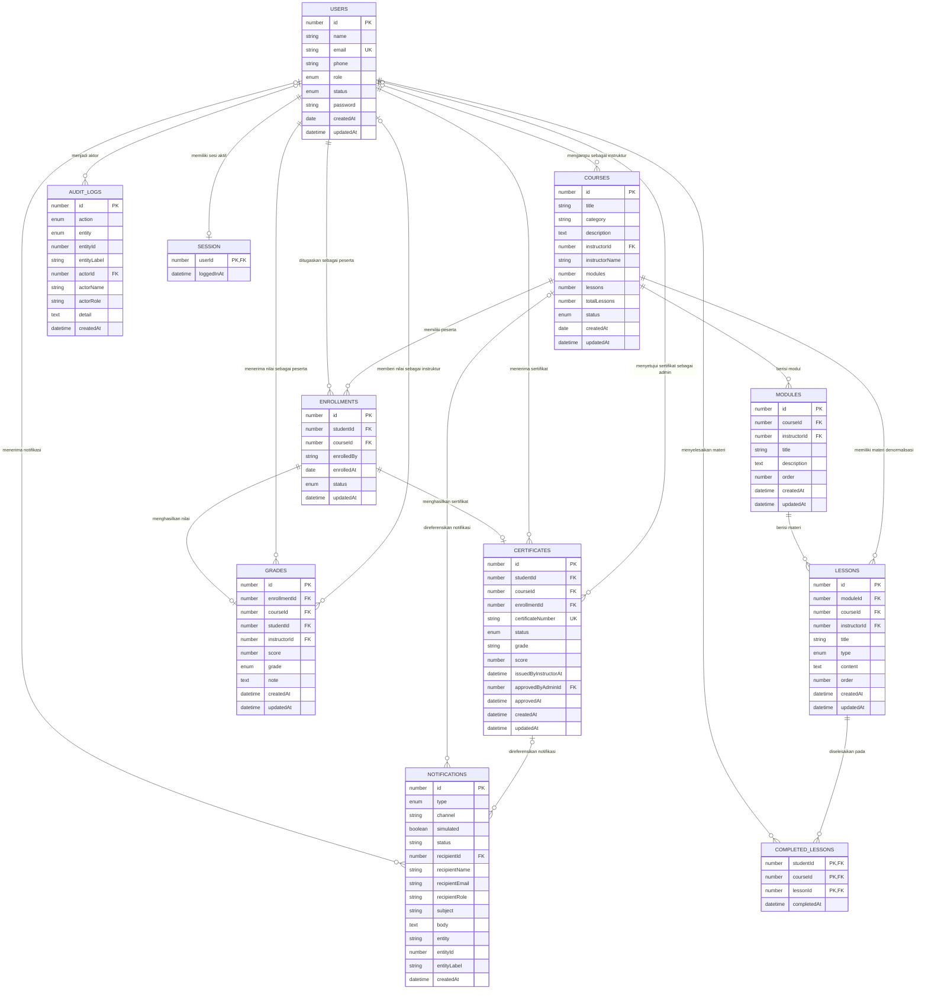

# ERD — ELIPS LMS

**Versi dokumen:** 2.0  
**Tanggal:** 2026-11-04  
**Status:** Dual-mode — skema fisik MySQL 8 + fallback koleksi `localStorage`  
**Dokumen terkait:** `prd.md`, `log.md`, `api/schema.sql`

---

## 1. Ringkasan

ELIPS LMS adalah aplikasi Learning Management System dengan tiga role: **Admin**, **Instruktur**, dan **Peserta**. Pada mode server, data disimpan di **MySQL 8** dengan 10 tabel domain dan foreign key fisik (lihat §13 dan §16). Pada mode fallback, data disimpan sebagai koleksi JSON di `localStorage` dengan model logis yang sama. Sesi login pada mode server disimpan di sesi PHP native, bukan tabel database.

Relasi utama:

```text
Admin ── mengelola ──► Pengguna, Kursus, Penugasan, Sertifikat
Instruktur ── mengampu ──► Kursus ── berisi ──► Modul ── berisi ──► Materi
Peserta ── ditugaskan melalui ──► Enrollment ──► Nilai ──► Sertifikat
Peserta ── menyelesaikan ──► CompletedLesson
Semua aktivitas penting ── dicatat ──► AuditLog
Publikasi kursus / penerbitan sertifikat ── menghasilkan ──► Notification
```

### 1.1 Cakupan

| Termasuk ERD | Tidak termasuk |
|---|---|
| 10 tabel domain MySQL dan koleksi `localStorage` yang setara | Halaman statis dan tampilan UI |
| Relasi, kardinalitas, foreign key, dan aturan hapus | Data pengaturan halaman Admin (belum dipersistensi) |
| Enum status dan lifecycle | Data laporan/statistik turunan (dihitung saat runtime) |
| Sesi PHP native (bukan tabel) | Integrasi email nyata (masih simulasi/outbox) |

---

## 2. Konvensi Notasi

| Simbol/Istilah | Arti |
|---|---|
| **PK** | Primary Key logis; ID unik di dalam koleksinya |
| **FK** | Foreign Key logis; referensi ke `id` koleksi lain |
| **UK** | Unique Key; kombinasi/field yang dijaga unik oleh kode aplikasi |
| `1 — N` | Satu baris memiliki banyak baris relasi |
| `1 — 0..1` | Satu baris memiliki nol atau satu baris relasi |
| `N — N` | Relasi banyak-ke-banyak melalui tabel penghubung |
| **Nullable** | Field boleh `null` atau tidak ada |
| **Snapshot** | Nilai disalin saat kejadian dan tidak otomatis berubah |
| **Denormalisasi** | Nilai duplikat untuk mempercepat pembacaan/tampilan |

Catatan penting:

- Tidak ada constraint database fisik. Integritas referensi dijaga oleh fungsi CRUD di `assets/js/crud-*.js`.
- ID setiap koleksi dibuat dengan `nextId()` = `max(id) + 1`, sehingga **ID tidak global** dan bisa dipakai ulang jika record dengan ID terbesar dihapus.
- Tipe data di bawah adalah tipe logis JSON: `number`, `string`, `boolean`, `date` (`YYYY-MM-DD`), `datetime` (ISO 8601), `enum`, `text`, `object`.

---

## 3. Diagram ERD



> **Cara membaca:** `USERS |o--o{ COURSES` berarti satu instruktur dapat mengampu nol atau banyak kursus, sedangkan satu kursus memiliki nol atau satu instruktur (boleh `null` setelah instruktur dilepas). Relasi peserta ke kursus bersifat **N—N** dan dipecah melalui `ENROLLMENTS`. Notasi `|o` di sisi `USERS` menandai FK yang boleh `null`; `||` menandai FK yang wajib terisi.

---

## 4. Entitas dan Storage Key (Mode Fallback `localStorage`)

Pada mode server, entitas yang sama disimpan di tabel MySQL bernama snake_case (mis. `USERS` → `users`). Pemetaan lengkap tabel, kolom, dan relasi fisik ada di §16; tabel berikut adalah key yang dipakai pada mode fallback.

| No | Entitas | Storage Key | Bentuk | Jumlah Relasi Utama |
|---|---|---|---|---|
| 1 | `USERS` | `elips_users` | Array of object | Pusat referensi role dan aktor |
| 2 | `COURSES` | `elips_courses` | Array of object | Instruktur, enrollment, modul, materi |
| 3 | `ENROLLMENTS` | `elips_enrollments` | Array of object | Penghubung peserta ↔ kursus |
| 4 | `MODULES` | `elips_modules` | Array of object | Milik kursus, berisi materi |
| 5 | `LESSONS` | `elips_lessons` | Array of object | Milik modul dan kursus |
| 6 | `GRADES` | `elips_grades` | Array of object | Milik enrollment/peserta/kursus |
| 7 | `CERTIFICATES` | `elips_certificates` | Array of object | Milik peserta/kursus/enrollment |
| 8 | `COMPLETED_LESSONS` | `elips_completedLessons` | Array of object (tanpa `id` di mode lokal) | Progres peserta per materi |
| 9 | `AUDIT_LOGS` | `elips_auditLogs` | Array of object | Aktor dan entitas polimorfik |
| 10 | `NOTIFICATIONS` | `elips_notifications` | Array of object | Penerima dan entitas polimorfik |
| 11 | `SESSION` | `elips_session` | Object tunggal | Sesi user yang sedang login (mode server: sesi PHP) |

Key lama yang dimigrasikan: `elips_enrolled` (self-enrollment) dipindahkan ke `elips_enrollments` oleh `seed.js`, lalu dihapus.

---

## 5. Kamus Data

### 5.1 USERS — `elips_users`

Menyimpan seluruh akun: Admin, Instruktur, dan Peserta.

| Field | Tipe | Key | Wajib | Default | Keterangan |
|---|---|---|---|---|---|
| `id` | number | PK | Ya | `max(id)+1` | ID unik pengguna |
| `name` | string | — | Ya | — | Nama lengkap |
| `email` | string | UK | Ya | — | Unik, dibandingkan case-insensitive |
| `phone` | string | — | Tidak | `''` | Nomor telepon |
| `role` | enum | — | Ya | `peserta` | `admin`, `instruktur`, `peserta` |
| `status` | enum | — | Ya | `aktif` | `aktif`, `nonaktif` |
| `password` | string | — | Ya | `elips123` untuk seed/akun lama | Mode lokal: disimpan apa adanya, minimal 8 karakter saat dibuat/diubah, diverifikasi `authenticateUser()`. Mode server: kolom `password_hash` di MySQL (bcrypt/argon2 via `password_hash()`), diverifikasi `password_verify()` di PHP, dan tidak pernah dikirim ke client |
| `createdAt` | date | — | Ya | hari ini | `YYYY-MM-DD` |
| `updatedAt` | datetime | — | Tidak | — | ISO 8601 saat diubah |

**Aturan:**

- `email` unik; `createUser` dan `updateUser` menolak duplikat.
- `password` wajib diisi saat `createUser` dan minimal 8 karakter; `seed.js` mengisi password demo untuk akun lama yang belum memilikinya.
- `authenticateUser(email, password)` menolak email tidak terdaftar, password kosong/salah, dan akun `nonaktif`.
- `id = 1` (Administrator utama) tidak dapat dihapus.
- Minimal satu akun `admin` harus tersisa.
- Menghapus peserta menghapus enrollment, nilai, sertifikat, dan progresnya.
- Menghapus instruktur melepas semua kursus yang diampu dan mengubah kursus Publish menjadi Draft.
- Mengubah role instruktur menjadi role lain melepas seluruh kursusnya.
- Menonaktifkan instruktur mengubah kursus Publish menjadi Draft, tetapi penugasan `instructorId` tetap tersimpan sampai diubah.

---

### 5.2 COURSES — `elips_courses`

Menyimpan kursus beserta instruktur pengampu dan status publikasinya.

| Field | Tipe | Key | Wajib | Default | Keterangan |
|---|---|---|---|---|---|
| `id` | number | PK | Ya | `max(id)+1` | ID unik kursus |
| `title` | string | — | Ya | — | Judul kursus |
| `category` | string | — | Ya | — | Kategori bebas, mis. `Pelatihan`, `Soft Skill`, `Administrasi`, `Reguler Class` |
| `description` | text | — | Tidak | `''` | Deskripsi kursus |
| `instructorId` | number | FK → `users.id` | Ya saat dibuat | — | Harus akun ber-role `instruktur` dan `aktif`; dapat menjadi `null` setelah dilepas |
| `instructorName` | string | — | Ya | dari user | Denormalisasi nama instruktur; disinkronkan saat nama berubah |
| `modules` | number | — | Ya | `0` | Counter jumlah modul; dihitung ulang oleh `syncCourseCounters` |
| `lessons` | number | — | Ya | `0` | Counter jumlah materi |
| `totalLessons` | number | — | Ya | `0` | Duplikat dari `lessons` untuk kompatibilitas tampilan |
| `status` | enum | — | Ya | `draft` | `draft`, `published` |
| `createdAt` | date | — | Ya | hari ini | `YYYY-MM-DD` |
| `updatedAt` | datetime | — | Tidak | — | ISO 8601 |

**Aturan:**

- Kursus baru **selalu** dibuat `draft`; status tidak dapat diubah lewat form edit.
- Publikasi hanya boleh jika:
  1. `instructorId` menunjuk instruktur berstatus `aktif`, dan
  2. kursus memiliki minimal **1 modul** dan **1 materi**.
- Menarik kursus ke Draft selalu diperbolehkan.
- Menghapus kursus menghapus seluruh modul, materi, enrollment, nilai, sertifikat, dan progres terkait.

**Lifecycle status:**

```text
draft ── publikasi (validasi lolos) ──► published
published ── tarik ke draft ──► draft
published ── instruktur dilepas/dihapus/nonaktif ──► draft
```

---

### 5.3 ENROLLMENTS — `elips_enrollments`

Tabel penghubung **N—N** antara peserta dan kursus.

| Field | Tipe | Key | Wajib | Default | Keterangan |
|---|---|---|---|---|---|
| `id` | number | PK | Ya | `max(id)+1` | ID unik penugasan |
| `studentId` | number | FK → `users.id` | Ya | — | Harus user ber-role `peserta` dan `aktif` |
| `courseId` | number | FK → `courses.id` | Ya | — | Kursus yang ditugaskan |
| `enrolledBy` | string | — | Ya | `admin` | Pencatat penugasan; data lama dapat berisi nilai lain |
| `enrolledAt` | date | — | Ya | hari ini | `YYYY-MM-DD` |
| `status` | enum | — | Ya | `active` | `active`, `dihentikan` |
| `updatedAt` | datetime | — | Tidak | — | ISO 8601 saat status berubah |

**Aturan:**

- Kombinasi `(studentId, courseId)` **unik**; penugasan ganda tidak dibuat.
- Satu peserta boleh memiliki banyak enrollment (banyak kursus).
- Satu kursus boleh memiliki banyak enrollment (banyak peserta).
- Menghapus enrollment juga menghapus nilai, sertifikat, dan progres peserta pada kursus tersebut.
- Status `dihentikan` menghentikan akses peserta, tetapi data nilai/sertifikat tidak otomatis dihapus.

---

### 5.4 MODULES — `elips_modules`

Modul pembelajaran di dalam kursus.

| Field | Tipe | Key | Wajib | Default | Keterangan |
|---|---|---|---|---|---|
| `id` | number | PK | Ya | `max(id)+1` | ID unik modul |
| `courseId` | number | FK → `courses.id` | Ya | — | Kursus pemilik modul |
| `instructorId` | number | FK → `users.id` | Tidak | dari kursus | Denormalisasi pemilik konten; disinkronkan dengan `course.instructorId` |
| `title` | string | — | Ya | — | Judul modul |
| `description` | text | — | Tidak | `''` | Deskripsi modul |
| `order` | number | — | Ya | `max(order)+1` | Urutan modul di dalam kursus, mulai dari 1 |
| `createdAt` | datetime | — | Ya | sekarang | ISO 8601 |
| `updatedAt` | datetime | — | Tidak | — | ISO 8601 |

**Aturan:**

- Instruktur hanya dapat mengelola modul pada kursus yang diampu.
- Menghapus modul menghapus seluruh materi di dalamnya beserta progres `completedLessons` terkait.
- `order` menentukan urutan tampilan modul.

---

### 5.5 LESSONS — `elips_lessons`

Materi/pelajaran di dalam modul.

| Field | Tipe | Key | Wajib | Default | Keterangan |
|---|---|---|---|---|---|
| `id` | number | PK | Ya | `max(id)+1` | ID unik materi |
| `moduleId` | number | FK → `modules.id` | Ya | — | Modul pemilik materi |
| `courseId` | number | FK → `courses.id` | Ya | dari modul | Denormalisasi untuk query cepat per kursus |
| `instructorId` | number | FK → `users.id` | Tidak | dari modul | Denormalisasi pemilik konten |
| `title` | string | — | Ya | — | Judul materi |
| `type` | enum | — | Ya | `text` | `text`, `video`, `file`, `link` |
| `content` | text | — | Bersyarat | — | HTML untuk `text` (boleh kosong, disanitasi dengan `sanitizeHtml`); URL/nama file **wajib** untuk `video`, `file`, dan `link` |
| `order` | number | — | Ya | `max(order)+1` | Urutan materi di dalam modul |
| `createdAt` | datetime | — | Ya | sekarang | ISO 8601 |
| `updatedAt` | datetime | — | Tidak | — | ISO 8601 |

**Aturan tipe konten:**

| Tipe | Isi `content` | Cara ditampilkan |
|---|---|---|
| `text` | HTML materi | Dirender sebagai artikel |
| `video` | URL video/embed | Diubah menjadi embed atau tautan video |
| `file` | URL/nama file | Tautan unduh |
| `link` | URL eksternal | Tautan keluar |

**Aturan relasi:**

- `moduleId` harus milik `courseId` yang sama.
- Memindahkan materi ke modul lain hanya diizinkan dalam kursus yang sama.
- Menghapus materi menghapus progres penyelesaian materi tersebut.
- Materi hanya dapat diakses peserta jika enrollment `active`, kursus `published`, dan urutan sebelumnya sudah selesai.

---

### 5.6 GRADES — `elips_grades`

Nilai akhir peserta per kursus.

| Field | Tipe | Key | Wajib | Default | Keterangan |
|---|---|---|---|---|---|
| `id` | number | PK | Ya | `max(id)+1` | ID unik nilai |
| `enrollmentId` | number | FK → `enrollments.id` | Ya | — | Penugasan yang dinilai |
| `courseId` | number | FK → `courses.id` | Ya | — | Denormalisasi untuk query |
| `studentId` | number | FK → `users.id` | Ya | — | Denormalisasi peserta |
| `instructorId` | number | FK → `users.id` | Tidak | `course.instructorId` | Instruktur pemberi nilai |
| `score` | number | — | Ya | — | Rentang 0–100 |
| `grade` | enum | — | Ya | turunan skor | `A`, `A-`, `B+`, `B`, `B-`, `C+`, `C`, `D`, `E` |
| `note` | text | — | Tidak | `''` | Catatan instruktur |
| `createdAt` | datetime | — | Ya | sekarang | ISO 8601 |
| `updatedAt` | datetime | — | Tidak | — | ISO 8601 |

**Konversi grade:**

| Skor | Grade |
|---|---|
| ≥ 90 | A |
| 80–89 | A- |
| 75–79 | B+ |
| 70–74 | B |
| 65–69 | B- |
| 60–64 | C+ |
| 55–59 | C |
| 50–54 | D |
| < 50 | E |

**Aturan:**

- Hanya boleh menilai jika enrollment `(studentId, courseId)` ada.
- Instruktur tidak dapat menilai kursus yang bukan miliknya.
- Kombinasi `(studentId, courseId)` dianggap unik; penyimpanan ulang memperbarui nilai yang sama.
- Menyimpan nilai otomatis membuat/memperbarui e-sertifikat **Draft**.
- Jika sertifikat sudah `publish`, perubahan nilai memperbarui data sertifikat tetapi **tidak** mengembalikan status ke Draft.

---

### 5.7 CERTIFICATES — `elips_certificates`

E-sertifikat peserta per kursus.

| Field | Tipe | Key | Wajib | Default | Keterangan |
|---|---|---|---|---|---|
| `id` | number | PK | Ya | `max(id)+1` | ID unik sertifikat |
| `studentId` | number | FK → `users.id` | Ya | — | Peserta penerima |
| `courseId` | number | FK → `courses.id` | Ya | — | Kursus terkait |
| `enrollmentId` | number | FK → `enrollments.id` | Tidak | dicari dari pasangan | Nullable untuk data lama |
| `certificateNumber` | string | UK | Ya | dibuat sistem | Draft: `CERT-DRAFT-xxxxxx-XXX`; Publish: `CERT-YYYY-XXXXXX` |
| `status` | enum | — | Ya | `draft` | `draft`, `publish` |
| `grade` | string | — | Ya | dari nilai | **Snapshot** grade saat sertifikat dibuat/diperbarui |
| `score` | number | — | Ya | dari nilai | **Snapshot** skor |
| `issuedByInstructorAt` | datetime | — | Ya | sekarang | Waktu instruktur menyimpan nilai |
| `approvedByAdminId` | number | FK → `users.id` | Tidak | `null` | Admin yang menyetujui |
| `approvedAt` | datetime | — | Tidak | `null` | Waktu persetujuan |
| `createdAt` | datetime | — | Ya | sekarang | ISO 8601 |
| `updatedAt` | datetime | — | Tidak | — | ISO 8601 |

**Field lama yang masih dibaca (kompatibilitas):** `courseName`, `issuedAt`.
**Normalisasi status:** `published`, `Publish`, `terbit`, `approved` dianggap `publish`; `menunggu`, `pending` dianggap `draft`; status kosong dianggap `publish` untuk data lama.

**Aturan:**

- Satu sertifikat per `(studentId, courseId)`.
- Sertifikat hanya dibuat jika peserta sudah memiliki nilai dan enrollment.
- Sertifikat baru selalu `draft`.
- Hanya Admin yang dapat mengubah `draft` → `publish`.
- Sertifikat `publish` bersifat final dari sisi status; nilai masih dapat diperbarui.
- Saat `publish`, nomor Draft diganti nomor final, `approvedByAdminId` dan `approvedAt` diisi.
- Sertifikat `draft` tidak boleh tampil di halaman peserta dan tidak dapat diverifikasi.
- Menghapus peserta/enrollment/kursus ikut menghapus sertifikat terkait.

**Lifecycle status:**

```text
(nilai disimpan) ──► draft ── approve Admin ──► publish
                         ▲
                         └── nilai diperbarui (tetap draft)
publish ── nilai diperbarui ──► tetap publish (data grade/score diperbarui)
```

---

### 5.8 COMPLETED_LESSONS — `elips_completedLessons`

Mencatat materi yang sudah diselesaikan peserta. **Tidak memiliki `id`**; identitasnya adalah kombinasi tiga field.

| Field | Tipe | Key | Wajib | Keterangan |
|---|---|---|---|---|
| `studentId` | number | PK komposit, FK → `users.id` | Ya | Peserta |
| `courseId` | number | PK komposit, FK → `courses.id` | Ya | Kursus (denormalisasi) |
| `lessonId` | number | PK komposit, FK → `lessons.id` | Ya | Materi yang diselesaikan |
| `completedAt` | datetime | — | Ya | ISO 8601 saat ditandai selesai |

**Aturan:**

- Kombinasi `(studentId, courseId, lessonId)` unik; penandaan ulang tidak menambah baris.
- Penulisan dilakukan dari halaman `learning.html` setelah validasi enrollment, status kursus, dan urutan materi.
- Menghapus materi/modul/kursus/enrollment/peserta menghapus baris progres terkait.
- Progres dihitung sebagai `jumlah baris selesai / jumlah materi kursus`.

---

### 5.9 AUDIT_LOGS — `elips_auditLogs`

Jejak audit perubahan data penting. Bersifat **append-only** dari sudut pandang aplikasi (hanya bisa dibersihkan seluruhnya dari halaman Admin).

| Field | Tipe | Key | Wajib | Keterangan |
|---|---|---|---|---|
| `id` | number | PK | Ya | ID unik log |
| `action` | enum | — | Ya | Lihat daftar aksi di bawah |
| `entity` | enum | — | Ya | `course`, `grade`, `certificate`, `user`, `enrollment`, `module`, `lesson` |
| `entityId` | number | FK polimorfik | Tidak | ID entitas yang berubah; `null` jika tidak ada |
| `entityLabel` | string | — | Tidak | Label entitas saat kejadian (snapshot) |
| `actorId` | number | FK → `users.id` | Tidak | `null` berarti Sistem |
| `actorName` | string | — | Ya | Snapshot nama aktor |
| `actorRole` | string | — | Ya | `admin`, `instruktur`, `peserta`, atau `sistem` |
| `detail` | text | — | Tidak | Deskripsi perubahan |
| `createdAt` | datetime | — | Ya | ISO 8601 |

**Enum aksi:**

| Aksi | Label UI | Dipicu oleh |
|---|---|---|
| `create` | Tambah | Buat user, kursus, enrollment, modul, materi |
| `update` | Ubah | Ubah user, kursus, modul, materi |
| `delete` | Hapus | Hapus user, kursus, modul, materi, enrollment |
| `publish` | Publish | Kursus dipublikasikan |
| `unpublish` | Draft | Kursus dikembalikan ke Draft |
| `grade` | Nilai | Instruktur menyimpan/memperbarui nilai |
| `submit` | Ajukan Draft | Sertifikat Draft dibuat/diajukan |
| `approve` | Setujui | Admin menyetujui sertifikat |
| `assign` | Penugasan | Penugasan instruktur ke kursus |
| `status` | Ubah Status | Perubahan status enrollment |

**Aturan:**

- `actorId` diresolusikan dengan prioritas: `actorId` eksplisit → user sesi → `null` (Sistem).
- Maksimal **1000 entri**; entri terbaru disimpan di depan.
- Log bersifat historis: penghapusan user/kursus tidak menghapus log, sehingga `actorId`/`entityId` dapat menjadi referensi yatim.
- `entityId` adalah **polimorfik**, bukan FK fisik ke satu tabel.

---

### 5.10 NOTIFICATIONS — `elips_notifications`

Outbox notifikasi email **simulasi**. Tidak ada pengiriman email nyata.

| Field | Tipe | Key | Wajib | Keterangan |
|---|---|---|---|---|
| `id` | number | PK | Ya | ID unik notifikasi |
| `type` | enum | — | Ya | `course_published`, `certificate_published` |
| `channel` | string | — | Ya | Selalu `email` |
| `simulated` | boolean | — | Ya | Selalu `true` |
| `status` | string | — | Ya | Selalu `sent` (status outbox simulasi) |
| `recipientId` | number | FK → `users.id` | Tidak | Nullable untuk data lama |
| `recipientName` | string | — | Ya | Snapshot nama penerima |
| `recipientEmail` | string | — | Ya | Email tujuan; harus valid saat dibuat |
| `recipientRole` | string | — | Ya | `admin`, `instruktur`, `peserta` |
| `subject` | string | — | Ya | Subjek email |
| `body` | text | — | Ya | Isi email |
| `entity` | string | — | Tidak | `course` atau `certificate` |
| `entityId` | number | FK polimorfik | Tidak | ID kursus/sertifikat |
| `entityLabel` | string | — | Tidak | Label entitas (snapshot) |
| `createdAt` | datetime | — | Ya | ISO 8601 |

**Aturan:**

- Dibuat saat kursus dipublikasikan:
  - penerima = seluruh peserta dengan enrollment `active` dan email valid;
  - ditambah instruktur aktif pengampu kursus.
- Dibuat saat sertifikat disetujui:
  - penerima = peserta pemilik sertifikat (jika email valid).
- Maksimal **1000 entri**; terbaru di depan.
- `recipientEmail` divalidasi dengan pola email sederhana.
- `recipientId`/`entityId` bersifat historis dan dapat menjadi referensi yatim setelah data dihapus.

---

### 5.11 SESSION — `elips_session`

Bukan koleksi, melainkan **satu objek** yang merepresentasikan sesi login aktif di browser.

| Field | Tipe | Key | Wajib | Keterangan |
|---|---|---|---|---|
| `userId` | number | FK → `users.id` | Ya | User yang sedang login |
| `loggedInAt` | datetime | — | Tidak | ISO 8601 saat login; sesi lama dapat tidak memilikinya |

**Aturan:**

- Ditulis oleh `setCurrentUser(userId)` saat login/registrasi dalam bentuk `{ userId, loggedInAt }`.
- `getSessionUser()` juga menerima sesi lama yang hanya berisi angka (`userId`) langsung.
- Dihapus oleh `logout()`.
- `getSessionUser()` mengembalikan `null` jika `userId` tidak lagi ditemukan.
- `getCurrentUser()` adalah alias `getSessionUser()`; **tidak ada** fallback berdasarkan path halaman. Tanpa sesi, hasilnya `null`.
- `requireRole(role)` hanya memakai `getSessionUser()`; tanpa sesi diarahkan ke `login.html`, role tidak sesuai diarahkan ke dashboard role-nya.
- Sesi tidak otomatis dihapus ketika user dihapus; ini dapat menghasilkan sesi yang menunjuk user tidak valid.

---

## 6. Relasi Lengkap

| No | Relasi | Kardinalitas | FK | Perilaku saat data induk dihapus | Catatan |
|---|---|---|---|---|---|
| R1 | `USERS` (instruktur) → `COURSES` | 1 — N | `courses.instructorId` | Instruktur dihapus/dilepas: `instructorId=null`, `instructorName=''`, kursus Publish → Draft | Satu kursus hanya satu instruktur; satu instruktur banyak kursus |
| R2 | `USERS` (peserta) → `ENROLLMENTS` | 1 — N | `enrollments.studentId` | Peserta dihapus: seluruh enrollment dihapus | Hanya untuk role `peserta` |
| R3 | `COURSES` → `ENROLLMENTS` | 1 — N | `enrollments.courseId` | Kursus dihapus: seluruh enrollment dihapus | Relasi N—N peserta ↔ kursus |
| R4 | `COURSES` → `MODULES` | 1 — N | `modules.courseId` | Kursus dihapus: seluruh modul dihapus | Modul tidak dapat berdiri sendiri |
| R5 | `MODULES` → `LESSONS` | 1 — N | `lessons.moduleId` | Modul dihapus: seluruh materi + progresnya dihapus | Satu materi hanya milik satu modul |
| R6 | `COURSES` → `LESSONS` | 1 — N | `lessons.courseId` | Kursus dihapus: seluruh materi dihapus | Denormalisasi dari modul |
| R7 | `ENROLLMENTS` → `GRADES` | 1 — 0..1 | `grades.enrollmentId` | Enrollment dihapus: nilai dihapus | Satu peserta satu nilai per kursus |
| R8 | `ENROLLMENTS` → `CERTIFICATES` | 1 — 0..1 | `certificates.enrollmentId` | Enrollment dihapus: sertifikat dihapus | Satu peserta satu sertifikat per kursus |
| R9 | `USERS` (peserta) → `GRADES` | 1 — N | `grades.studentId` | Peserta dihapus: seluruh nilai dihapus | Denormalisasi untuk query |
| R10 | `USERS` (instruktur) → `GRADES` | 1 — N | `grades.instructorId` | Instruktur dihapus: nilai tetap ada | Referensi dapat menjadi yatim |
| R11 | `USERS` (peserta) → `CERTIFICATES` | 1 — N | `certificates.studentId` | Peserta dihapus: seluruh sertifikat dihapus | Denormalisasi untuk query |
| R12 | `USERS` (admin) → `CERTIFICATES` | 1 — N | `certificates.approvedByAdminId` | Admin dihapus: sertifikat tetap ada | Riwayat approval dipertahankan |
| R13 | `USERS` (peserta) → `COMPLETED_LESSONS` | 1 — N | `completedLessons.studentId` | Peserta dihapus: seluruh progres dihapus | — |
| R14 | `LESSONS` → `COMPLETED_LESSONS` | 1 — N | `completedLessons.lessonId` | Materi/modul dihapus: progres terkait dihapus | Progres per materi |
| R15 | `USERS` → `AUDIT_LOGS` | 1 — N | `auditLogs.actorId` | User dihapus: log tetap ada | Snapshot aktor disimpan |
| R16 | `USERS` → `NOTIFICATIONS` | 1 — N | `notifications.recipientId` | User dihapus: notifikasi tetap ada | Snapshot penerima disimpan |
| R17 | `COURSES` / `CERTIFICATES` → `NOTIFICATIONS` | 1 — N | `notifications.entity` + `entityId` | Entitas dihapus: notifikasi tetap ada | Referensi polimorfik, bukan FK fisik |
| R18 | `USERS` → `SESSION` | 1 — 0..1 | `session.userId` | Tidak ada cascade | Sesi dihapus saat logout |

### 6.1 Relasi Banyak-ke-Banyak

| Relasi | Tabel Penghubung | Atribut Penghubung | Keunikan |
|---|---|---|---|
| Peserta ↔ Kursus | `ENROLLMENTS` | `status`, `enrolledAt`, `enrolledBy` | `(studentId, courseId)` |
| Peserta ↔ Materi (progres) | `COMPLETED_LESSONS` | `completedAt` | `(studentId, courseId, lessonId)` |

---

## 7. Aturan Integritas dan Validasi

### 7.1 Integritas Referensi

| Aturan | Penegak |
|---|---|
| Email pengguna unik | `crud-users.js` |
| Role hanya `admin`/`instruktur`/`peserta` | `core.isValidRole` + `crud-users.js` |
| Status user hanya `aktif`/`nonaktif` | `core.isValidUserStatus` |
| Password wajib minimal 8 karakter saat create; opsional saat update | `crud-users.js` |
| Login hanya untuk email/password valid dan akun aktif | `crud-users.js` (`authenticateUser`) |
| Halaman role hanya dapat dibuka dengan sesi dan role yang sesuai | `auth.js` (`requireRole`) |
| Konten materi teks disanitasi sebelum disimpan/dirender | `utils.js` (`sanitizeHtml`), `crud-content.js`, `learning.html` |
| Kursus wajib punya instruktur aktif saat dibuat/diubah | `crud-courses.js` + `core.isActiveInstructor` |
| Publikasi kursus wajib punya instruktur aktif, modul, dan materi | `crud-courses.js` |
| Enrollment hanya untuk peserta aktif | `crud-enrollments.js` |
| Enrollment unik per peserta+kursus | `crud-enrollments.js` |
| Nilai hanya untuk enrollment yang valid | `crud-grades.js` |
| Skor 0–100 | `crud-grades.js` |
| Instruktur hanya mengelola/menilai kursus sendiri | `crud-content.js`, `crud-grades.js` |
| Sertifikat hanya untuk peserta bernilai | `crud-grades.js` |
| Approve hanya untuk sertifikat Draft | `crud-grades.js` |
| Sertifikat Publish yang terlihat peserta | `data.js` + filter halaman peserta |

### 7.2 Integritas pada Mode Fallback

Pada mode fallback `localStorage` tidak ada database relasional, sehingga hal berikut hanya dijaga oleh kode dan dapat rusak jika penyimpanan diedit manual:

- Referensi `instructorId`, `courseId`, `moduleId`, `lessonId`, `studentId`, `enrollmentId` tidak memiliki constraint FK.
- Tidak ada `ON DELETE CASCADE` otomatis; cascade dilakukan manual di fungsi CRUD.
- Tidak ada transaksi; operasi multi-koleksi dapat berhenti di tengah jika terjadi error.
- ID dapat dipakai ulang setelah record ber-ID terbesar dihapus.
- Tipe data tidak dipaksa saat data dibaca dari `localStorage`.

Pada mode server, integritas referensial ditegakkan MySQL melalui foreign key dan `ON DELETE` (lihat §16.4), sedangkan operasi multi-tabel memakai transaksi eksplisit di `api/actions.php`.

### 7.3 Aturan Akses Peserta

Peserta dapat membuka materi jika **semua** kondisi terpenuhi:

1. Ada sesi peserta yang valid.
2. Enrollment `(studentId, courseId)` berstatus `active`.
3. Kursus berstatus `published`.
4. Materi berada pada urutan yang sudah terbuka; materi berikutnya terkunci sampai materi sebelumnya selesai.

Sertifikat hanya terlihat jika `status = publish` dan milik peserta yang sedang login.

---

## 8. Status Lifecycle

| Entitas | Field | Nilai | Transisi yang Diizinkan |
|---|---|---|---|
| Pengguna | `status` | `aktif`, `nonaktif` | aktif ↔ nonaktif |
| Pengguna | `role` | `admin`, `instruktur`, `peserta` | Dapat diubah; perubahan dari instruktur melepas kursus |
| Kursus | `status` | `draft`, `published` | draft → published (validasi), published → draft |
| Enrollment | `status` | `active`, `dihentikan` | active ↔ dihentikan |
| Sertifikat | `status` | `draft`, `publish` | draft → publish; publish tidak kembali ke draft |
| Nilai | `grade` | A … E | Dihitung ulang setiap skor disimpan |
| Notifikasi | `status` | `sent` | Tidak berubah (simulasi) |

---

## 9. Denormalisasi dan Snapshot

| Lokasi | Data | Sumber | Sinkronisasi |
|---|---|---|---|
| `courses.instructorName` | Nama instruktur | `users.name` | `syncInstructorNameOnCourses` saat user diubah |
| `courses.modules` | Jumlah modul | `modules` | `syncCourseCounters` |
| `courses.lessons` | Jumlah materi | `lessons` | `syncCourseCounters` |
| `courses.totalLessons` | Duplikat jumlah materi | `courses.lessons` | `syncCourseCounters` |
| `modules.instructorId` | Pemilik konten | `courses.instructorId` | `syncAllContentOwners` |
| `lessons.instructorId` | Pemilik konten | `courses.instructorId` | `syncAllContentOwners` |
| `lessons.courseId` | Kursus materi | `modules.courseId` | Diset saat create/update |
| `grades.studentId`, `grades.courseId` | Pasangan peserta+kursus | `enrollments` | Diset saat nilai disimpan |
| `grades.enrollmentId` | Enrollment | `enrollments` | Diset saat nilai disimpan |
| `certificates.studentId`, `certificates.courseId` | Pasangan peserta+kursus | `enrollments` | Diset saat sertifikat dibuat |
| `certificates.enrollmentId` | Enrollment | `enrollments` | Diset saat sertifikat dibuat |
| `certificates.grade`, `certificates.score` | Nilai saat terbit | `grades` | Snapshot; diperbarui saat nilai disimpan ulang |
| `auditLogs.actorName`, `actorRole`, `entityLabel` | Identitas saat kejadian | `users`/entitas | Snapshot historis |
| `notifications.recipientName`, `recipientEmail`, `recipientRole`, `entityLabel` | Data saat notifikasi dibuat | `users`/entitas | Snapshot historis |

**Tujuan:**

- Denormalisasi mempercepat pembacaan tanpa join.
- Snapshot menjaga histori tetap akurat meskipun nama pengguna atau judul kursus berubah.

---

## 10. Matriks Cascade

| Operasi | COURSES | ENROLLMENTS | MODULES | LESSONS | GRADES | CERTIFICATES | COMPLETED_LESSONS | AUDIT_LOGS | NOTIFICATIONS | SESSION |
|---|---|---|---|---|---|---|---|---|---|---|
| Hapus **User peserta** | — | Hapus milik peserta | — | — | Hapus milik peserta | Hapus milik peserta | Hapus milik peserta | Tetap | Tetap | Tetap |
| Hapus **User instruktur** | Lepas & Draft | — | Owner di-reset | Owner di-reset | Tetap | Tetap | — | Tetap | Tetap | Tetap |
| Hapus **User admin** | — | — | — | — | — | Tetap | — | Tetap | Tetap | Tetap |
| **Nonaktifkan User instruktur** | Publish → Draft (owner tetap) | — | — | — | — | — | — | Tambah log | Tetap | Tetap |
| Hapus **Kursus** | Hapus | Hapus | Hapus | Hapus | Hapus | Hapus | Hapus | Tetap | Tetap | — |
| Hapus **Enrollment** | — | Hapus | — | — | Hapus pasangan | Hapus pasangan | Hapus pasangan | Tetap | Tetap | — |
| Hapus **Modul** | Counter update | — | Hapus | Hapus isi modul | Tetap | Tetap | Hapus milik materi | Tetap | Tetap | — |
| Hapus **Materi** | Counter update | — | — | Hapus | Tetap | Tetap | Hapus milik materi | Tetap | Tetap | — |
| **Approve sertifikat** | — | — | — | — | — | Draft → Publish | — | Tambah log | Tambah notifikasi | — |
| **Publikasi kursus** | Draft → Publish | — | — | — | — | — | — | Tambah log | Tambah notifikasi | — |

Keterangan:

- “Tetap” berarti record tidak dihapus dan dapat menyimpan referensi yang sudah tidak valid (yatim).
- `AUDIT_LOGS` dan `NOTIFICATIONS` sengaja tidak di-cascade agar histori operasional tetap utuh.

---

## 11. Contoh Data

### 11.1 Pengguna

```json
{
  "id": 5,
  "name": "Budi Santoso",
  "email": "budi.student@example.com",
  "phone": "081234567894",
  "role": "peserta",
  "status": "aktif",
  "createdAt": "2026-10-01"
}
```

### 11.2 Kursus

```json
{
  "id": 1,
  "title": "Pelatihan Manajemen Dasar",
  "category": "Pelatihan",
  "description": "Pelatihan konsep dasar manajemen.",
  "instructorId": 2,
  "instructorName": "Ahmad Fauzi, M.M.",
  "modules": 8,
  "lessons": 24,
  "totalLessons": 24,
  "status": "published",
  "createdAt": "2026-09-20"
}
```

### 11.3 Enrollment

```json
{
  "id": 1,
  "studentId": 5,
  "courseId": 1,
  "enrolledBy": "admin",
  "enrolledAt": "2026-10-01",
  "status": "active"
}
```

### 11.4 Modul dan Materi

```json
{
  "id": 1,
  "courseId": 1,
  "instructorId": 2,
  "title": "Modul 1: Pengantar Manajemen",
  "description": "Materi pengantar manajemen.",
  "order": 1,
  "createdAt": "2026-09-20T00:00:00.000Z"
}
```

```json
{
  "id": 1,
  "moduleId": 1,
  "courseId": 1,
  "instructorId": 2,
  "title": "1.1 Pengantar Manajemen - Konsep Dasar",
  "type": "text",
  "content": "<p>Materi pengantar manajemen.</p>",
  "order": 1,
  "createdAt": "2026-09-20T00:00:00.000Z"
}
```

### 11.5 Nilai

```json
{
  "id": 1,
  "enrollmentId": 1,
  "courseId": 1,
  "studentId": 5,
  "instructorId": 2,
  "score": 88,
  "grade": "A-",
  "note": "Pemahaman materi baik.",
  "createdAt": "2026-11-03T07:25:19.822Z",
  "updatedAt": "2026-11-03T07:25:19.822Z"
}
```

### 11.6 Sertifikat

```json
{
  "id": 1,
  "studentId": 5,
  "courseId": 1,
  "enrollmentId": 1,
  "certificateNumber": "CERT-2026-86832A",
  "status": "publish",
  "grade": "A-",
  "score": 88,
  "issuedByInstructorAt": "2026-11-03T07:25:19.822Z",
  "approvedByAdminId": 1,
  "approvedAt": "2026-11-03T07:25:19.823Z",
  "createdAt": "2026-11-03T07:25:19.822Z"
}
```

### 11.7 Progres Materi

```json
{
  "studentId": 5,
  "courseId": 1,
  "lessonId": 1,
  "completedAt": "2026-11-03T08:00:00.000Z"
}
```

### 11.8 Audit Log

```json
{
  "id": 12,
  "action": "approve",
  "entity": "certificate",
  "entityId": 1,
  "entityLabel": "CERT-2026-86832A",
  "actorId": 1,
  "actorName": "Administrator",
  "actorRole": "admin",
  "detail": "Menyetujui e-sertifikat Draft menjadi Publish untuk Budi Santoso.",
  "createdAt": "2026-11-03T07:25:19.823Z"
}
```

### 11.9 Notifikasi

```json
{
  "id": 3,
  "type": "certificate_published",
  "channel": "email",
  "simulated": true,
  "status": "sent",
  "recipientId": 5,
  "recipientName": "Budi Santoso",
  "recipientEmail": "budi.student@example.com",
  "recipientRole": "peserta",
  "subject": "E-sertifikat \"Pelatihan Manajemen Dasar\" telah terbit",
  "body": "Halo Budi Santoso, ...",
  "entity": "certificate",
  "entityId": 1,
  "entityLabel": "CERT-2026-86832A",
  "createdAt": "2026-11-03T07:25:19.824Z"
}
```

### 11.10 Sesi

```json
{
  "userId": 5,
  "loggedInAt": "2026-11-03T08:00:00.000Z"
}
```

---

## 12. Pola Query dan Index Logis

| Kebutuhan | Sumber | Pola Pencarian |
|---|---|---|
| Login | `USERS` | Cari `email` (case-insensitive), cek `status` |
| Daftar peserta | `USERS` | Filter `role = peserta` |
| Instruktur aktif | `USERS` | Filter `role = instruktur` dan `status = aktif` |
| Kursus publik | `COURSES` | Filter `status = published` |
| Kursus per instruktur | `COURSES` | Filter `instructorId` |
| Kursus peserta | `ENROLLMENTS` | Filter `studentId`, lalu ambil `COURSES` |
| Peserta kursus | `ENROLLMENTS` | Filter `courseId`, lalu ambil `USERS` |
| Struktur kursus | `MODULES` + `LESSONS` | Filter `courseId`, urutkan `order` |
| Materi per modul | `LESSONS` | Filter `moduleId`, urutkan `order` |
| Nilai peserta | `GRADES` | Kombinasi `studentId` + `courseId` |
| Sertifikat peserta | `CERTIFICATES` | Kombinasi `studentId` + `courseId` |
| Verifikasi sertifikat | `CERTIFICATES` | Cari `certificateNumber` (uppercase), cek `publish` |
| Progres | `COMPLETED_LESSONS` | Kombinasi `studentId` + `courseId` + `lessonId` |
| Audit | `AUDIT_LOGS` | Urut `createdAt` desc, filter aksi/entitas/aktor/tanggal |
| Notifikasi | `NOTIFICATIONS` | Urut `createdAt` desc, filter tipe/penerima/tanggal |

### 12.1 Index yang Dipakai di MySQL

- `users(email)` unik
- `courses(instructor_id)`, `courses(status)`
- `enrollments(student_id, course_id)` unik, `enrollments(course_id)`
- `modules(course_id, sort_order)`, `modules(instructor_id)`
- `lessons(module_id, sort_order)`, `lessons(course_id)`, `lessons(instructor_id)`
- `grades(student_id, course_id)` unik, `grades(enrollment_id)`, `grades(instructor_id)`
- `certificates(student_id, course_id)` unik, `certificates(certificate_number)` unik, `certificates(status)`
- `completed_lessons(student_id, lesson_id)` unik, `completed_lessons(course_id)`
- `audit_logs(created_at)`, `audit_logs(actor_id)`, `audit_logs(entity)`
- `notifications(created_at)`, `notifications(type)`, `notifications(recipient_id)`

---

## 13. Skema Fisik MySQL (Terimplementasi)

Skema fisik ada di `api/schema.sql` dan dibuat oleh `api/install.php`. Pemetaan entitas logis ke tabel:

| Entitas Logis | Tabel | Primary Key | Foreign Key / Unique |
|---|---|---|---|
| `USERS` | `users` | `id` | `email` UNIQUE |
| `COURSES` | `courses` | `id` | `instructor_id` → `users.id` ON DELETE SET NULL |
| `ENROLLMENTS` | `enrollments` | `id` | `student_id` → `users.id` CASCADE; `course_id` → `courses.id` CASCADE; UNIQUE(`student_id`, `course_id`) |
| `MODULES` | `modules` | `id` | `course_id` → `courses.id` ON DELETE CASCADE; `instructor_id` → `users.id` SET NULL |
| `LESSONS` | `lessons` | `id` | `module_id` → `modules.id` CASCADE; `course_id` → `courses.id` CASCADE; `instructor_id` → `users.id` SET NULL |
| `GRADES` | `grades` | `id` | `enrollment_id` → `enrollments.id` CASCADE; `student_id`/`course_id` → CASCADE; `instructor_id` SET NULL; UNIQUE(`student_id`, `course_id`) |
| `CERTIFICATES` | `certificates` | `id` | `enrollment_id` → `enrollments.id` CASCADE; `student_id`/`course_id` CASCADE; `approved_by_admin_id` SET NULL; UNIQUE(`student_id`, `course_id`), `certificate_number` UNIQUE |
| `COMPLETED_LESSONS` | `completed_lessons` | `id` | UNIQUE(`student_id`, `lesson_id`); FK ke `users`, `courses`, `lessons` CASCADE |
| `AUDIT_LOGS` | `audit_logs` | `id` | `actor_id` → `users.id` SET NULL (polimorfik `entity` + `entity_id`) |
| `NOTIFICATIONS` | `notifications` | `id` | `recipient_id` → `users.id` SET NULL |
| `SESSION` | Sesi PHP native | — | Tidak ada tabel `sessions`; cookie sesi hanya menyimpan ID sesi |

**Catatan implementasi:**

- `entity` + `entity_id` pada audit/notifikasi tetap polimorfik.
- Password disimpan sebagai `password_hash` (bcrypt/argon2 via `password_hash()`); login divalidasi di server.
- Operasi cascade multi-tabel memakai foreign key dan transaksi eksplisit (mis. hapus enrollment).
- `created_at`/`updated_at` memakai `DATE`/`DATETIME` UTC; snapshot mengirim ISO 8601.
- Nama instruktur dan counter modul/materi tidak didenormalisasi di tabel; nilainya dihitung lewat JOIN/subquery saat snapshot dibangun.

---

## 14. Catatan Implementasi Mode Fallback `localStorage`

| Aspek | Perilaku Mode Fallback |
|---|---|
| Pembacaan | `ELIPS.read(key, fallback)` melakukan `JSON.parse`; error dikembalikan sebagai fallback |
| Penulisan | `ELIPS.write(key, value)` melakukan `JSON.stringify` |
| ID | `ELIPS.nextId(list)` = `max(id)+1` per koleksi |
| Normalisasi | `seed.js` menjalankan migrasi saat modul dimuat, termasuk normalisasi sertifikat; dilewati pada mode server |
| Batas log | Audit dan notifikasi maksimal 1000 entri, terbaru di depan |
| Isolasi | Data per browser/perangkat; tidak sinkron antar perangkat |
| Keamanan | Tidak ada enkripsi; password demo diverifikasi di client tetapi tersimpan apa adanya di `localStorage`. Guard role juga client-side. Mode ini bukan untuk produksi |
| Sinkronisasi tab | Halaman peserta menyegarkan tampilan saat event `storage` atau saat tab aktif kembali |

Pada mode server, `api.js` mengganti `ELIPS.read`/`ELIPS.write` dengan cache snapshot dari MySQL, sehingga modul data dan UI tetap sinkron tanpa perubahan besar.

---

## 15. Ringkasan Relasi Inti

```text
USERS (instruktur) 1 ─── N COURSES
USERS (peserta)    1 ─── N ENROLLMENTS N ─── 1 COURSES
COURSES            1 ─── N MODULES    1 ─── N LESSONS
COURSES            1 ─── N LESSONS    (denormalisasi)
ENROLLMENTS        1 ─── 0..1 GRADES
ENROLLMENTS        1 ─── 0..1 CERTIFICATES
USERS (peserta)    1 ─── N GRADES / CERTIFICATES / COMPLETED_LESSONS
LESSONS            1 ─── N COMPLETED_LESSONS
USERS              1 ─── N AUDIT_LOGS / NOTIFICATIONS
USERS              1 ─── 0..1 SESSION
```

Dengan demikian, inti model data ELIPS LMS adalah:

- **Kursus** sebagai pusat konten, dimiliki satu **Instruktur**.
- **Enrollment** sebagai penghubung peserta ke kursus.
- **Nilai** dan **Sertifikat** sebagai hasil akhir pembelajaran per pasangan peserta–kursus.
- **CompletedLessons** sebagai bukti progres per materi.
- **AuditLogs** dan **Notifications** sebagai catatan operasional yang bersifat historis.

---

## 16. Skema Fisik MySQL 8 (Terimplementasi)

Bagian ini mendokumentasikan skema yang benar-benar dieksekusi oleh `api/schema.sql` (database `elips_lms`, `ENGINE=InnoDB`, `utf8mb4_unicode_ci`, timezone koneksi UTC). Installer `api/install.php` membuat database, menjalankan skema, lalu mengisi data demo.

### 16.1 Ringkasan Tabel

| # | Tabel | Fungsi | Kolom kunci | Relasi utama |
|---|---|---|---|---|
| 1 | `users` | Akun Admin, Instruktur, Peserta | `id`, `email`, `password_hash`, `role`, `status` | — |
| 2 | `courses` | Kursus dan instruktur pengampu | `id`, `title`, `instructor_id`, `status` | `instructor_id` → `users.id` |
| 3 | `modules` | Modul di dalam kursus | `id`, `course_id`, `instructor_id`, `sort_order` | `course_id` → `courses.id` |
| 4 | `lessons` | Materi di dalam modul | `id`, `module_id`, `course_id`, `type`, `content`, `sort_order` | `module_id` → `modules.id`; `course_id` → `courses.id` |
| 5 | `enrollments` | Penugasan peserta ke kursus | `id`, `student_id`, `course_id`, `enrolled_at`, `status` | `student_id` → `users.id`; `course_id` → `courses.id` |
| 6 | `grades` | Nilai akhir per peserta–kursus | `id`, `enrollment_id`, `student_id`, `course_id`, `score`, `grade` | `enrollment_id` → `enrollments.id` |
| 7 | `certificates` | E-sertifikat Draft/Publish | `id`, `enrollment_id`, `student_id`, `course_id`, `certificate_number`, `status` | `enrollment_id` → `enrollments.id`; `approved_by_admin_id` → `users.id` |
| 8 | `completed_lessons` | Progres materi per peserta | `id`, `student_id`, `course_id`, `lesson_id`, `completed_at` | `student_id` → `users.id`; `lesson_id` → `lessons.id` |
| 9 | `audit_logs` | Jejak audit operasional | `id`, `action`, `entity`, `entity_id`, `actor_id`, `created_at` | `actor_id` → `users.id` |
| 10 | `notifications` | Outbox notifikasi email simulasi | `id`, `type`, `recipient_id`, `recipient_email`, `subject`, `created_at` | `recipient_id` → `users.id` |

Sesi login **tidak** memakai tabel: autentikasi memakai sesi PHP native (`$_SESSION`) dengan cookie `HttpOnly` dan `SameSite=Lax`.

### 16.2 Definisi Kolom

**`users`**

| Kolom | Tipe | Null | Default | Keterangan |
|---|---|---|---|---|
| `id` | `INT UNSIGNED` | tidak | AUTO_INCREMENT | Primary key |
| `name` | `VARCHAR(150)` | tidak | — | Nama lengkap |
| `email` | `VARCHAR(190)` | tidak | — | Unik, dipakai login |
| `phone` | `VARCHAR(40)` | tidak | `''` | Nomor telepon |
| `password_hash` | `VARCHAR(255)` | tidak | — | `password_hash()`; tidak pernah masuk snapshot |
| `role` | `ENUM('admin','instruktur','peserta')` | tidak | `'peserta'` | Role akun |
| `status` | `ENUM('aktif','nonaktif')` | tidak | `'aktif'` | Status akun |
| `created_at` | `DATE` | tidak | `CURRENT_DATE` | Tanggal dibuat |
| `updated_at` | `DATETIME` | ya | `NULL` | Waktu perubahan terakhir (UTC) |

**`courses`**

| Kolom | Tipe | Null | Default | Keterangan |
|---|---|---|---|---|
| `id` | `INT UNSIGNED` | tidak | AUTO_INCREMENT | Primary key |
| `title` | `VARCHAR(200)` | tidak | — | Judul kursus |
| `category` | `VARCHAR(100)` | tidak | — | Kategori |
| `description` | `TEXT` | tidak | — | Deskripsi |
| `instructor_id` | `INT UNSIGNED` | ya | `NULL` | Satu instruktur pengampu |
| `status` | `ENUM('draft','published')` | tidak | `'draft'` | Lifecycle kursus |
| `created_at` | `DATE` | tidak | `CURRENT_DATE` | Tanggal dibuat |
| `updated_at` | `DATETIME` | ya | `NULL` | Waktu perubahan terakhir |

**`modules`**

| Kolom | Tipe | Null | Default | Keterangan |
|---|---|---|---|---|
| `id` | `INT UNSIGNED` | tidak | AUTO_INCREMENT | Primary key |
| `course_id` | `INT UNSIGNED` | tidak | — | Kursus induk |
| `instructor_id` | `INT UNSIGNED` | ya | `NULL` | Instruktur pemilik konten |
| `title` | `VARCHAR(200)` | tidak | — | Judul modul |
| `description` | `TEXT` | tidak | — | Deskripsi |
| `sort_order` | `INT UNSIGNED` | tidak | `1` | Urutan dalam kursus |
| `created_at` | `DATETIME` | tidak | `CURRENT_TIMESTAMP` | Waktu dibuat |
| `updated_at` | `DATETIME` | ya | `NULL` | Waktu perubahan terakhir |

**`lessons`**

| Kolom | Tipe | Null | Default | Keterangan |
|---|---|---|---|---|
| `id` | `INT UNSIGNED` | tidak | AUTO_INCREMENT | Primary key |
| `module_id` | `INT UNSIGNED` | tidak | — | Modul induk |
| `course_id` | `INT UNSIGNED` | tidak | — | Kursus induk (denormalisasi untuk query cepat) |
| `instructor_id` | `INT UNSIGNED` | ya | `NULL` | Instruktur pemilik konten |
| `title` | `VARCHAR(200)` | tidak | — | Judul materi |
| `type` | `ENUM('text','video','file','link')` | tidak | `'text'` | Jenis materi |
| `content` | `LONGTEXT` | tidak | — | HTML/URL; HTML teks disanitasi server |
| `sort_order` | `INT UNSIGNED` | tidak | `1` | Urutan dalam modul |
| `created_at` | `DATETIME` | tidak | `CURRENT_TIMESTAMP` | Waktu dibuat |
| `updated_at` | `DATETIME` | ya | `NULL` | Waktu perubahan terakhir |

**`enrollments`**

| Kolom | Tipe | Null | Default | Keterangan |
|---|---|---|---|---|
| `id` | `INT UNSIGNED` | tidak | AUTO_INCREMENT | Primary key |
| `student_id` | `INT UNSIGNED` | tidak | — | Peserta |
| `course_id` | `INT UNSIGNED` | tidak | — | Kursus |
| `enrolled_by` | `VARCHAR(50)` | tidak | `'admin'` | Sumber penugasan |
| `enrolled_at` | `DATE` | tidak | `CURRENT_DATE` | Tanggal penugasan |
| `status` | `ENUM('active','dihentikan')` | tidak | `'active'` | Status penugasan |
| `created_at` | `DATETIME` | tidak | `CURRENT_TIMESTAMP` | Waktu dibuat |
| `updated_at` | `DATETIME` | ya | `NULL` | Waktu perubahan terakhir |

**`grades`**

| Kolom | Tipe | Null | Default | Keterangan |
|---|---|---|---|---|
| `id` | `INT UNSIGNED` | tidak | AUTO_INCREMENT | Primary key |
| `enrollment_id` | `INT UNSIGNED` | ya | `NULL` | Enrollment terkait |
| `course_id` | `INT UNSIGNED` | tidak | — | Kursus |
| `student_id` | `INT UNSIGNED` | tidak | — | Peserta |
| `instructor_id` | `INT UNSIGNED` | ya | `NULL` | Instruktur penilai |
| `score` | `TINYINT UNSIGNED` | tidak | — | Nilai 0–100 |
| `grade` | `CHAR(2)` | tidak | — | Huruf mutu (A, A-, B+, …) |
| `note` | `TEXT` | tidak | — | Catatan penilaian |
| `created_at` | `DATETIME` | tidak | `CURRENT_TIMESTAMP` | Waktu dibuat |
| `updated_at` | `DATETIME` | ya | `NULL` | Waktu perubahan terakhir |

**`certificates`**

| Kolom | Tipe | Null | Default | Keterangan |
|---|---|---|---|---|
| `id` | `INT UNSIGNED` | tidak | AUTO_INCREMENT | Primary key |
| `student_id` | `INT UNSIGNED` | tidak | — | Peserta |
| `course_id` | `INT UNSIGNED` | tidak | — | Kursus |
| `enrollment_id` | `INT UNSIGNED` | ya | `NULL` | Enrollment terkait |
| `certificate_number` | `VARCHAR(80)` | tidak | — | Nomor unik (`CERT-DRAFT-*` → `CERT-YYYY-*`) |
| `status` | `ENUM('draft','publish')` | tidak | `'draft'` | Hanya `publish` tampil ke peserta |
| `grade` | `CHAR(2)` | ya | `NULL` | Huruf mutu saat terbit |
| `score` | `TINYINT UNSIGNED` | ya | `NULL` | Nilai saat terbit |
| `issued_by_instructor_at` | `DATETIME` | ya | `NULL` | Waktu draft dibuat instruktur |
| `approved_by_admin_id` | `INT UNSIGNED` | ya | `NULL` | Admin penyetuju |
| `approved_at` | `DATETIME` | ya | `NULL` | Waktu approval |
| `created_at` | `DATETIME` | tidak | `CURRENT_TIMESTAMP` | Waktu dibuat |
| `updated_at` | `DATETIME` | ya | `NULL` | Waktu perubahan terakhir |

**`completed_lessons`**

| Kolom | Tipe | Null | Default | Keterangan |
|---|---|---|---|---|
| `id` | `INT UNSIGNED` | tidak | AUTO_INCREMENT | Primary key |
| `student_id` | `INT UNSIGNED` | tidak | — | Peserta |
| `course_id` | `INT UNSIGNED` | tidak | — | Kursus |
| `lesson_id` | `INT UNSIGNED` | tidak | — | Materi yang diselesaikan |
| `completed_at` | `DATETIME` | tidak | `CURRENT_TIMESTAMP` | Waktu selesai |

**`audit_logs`**

| Kolom | Tipe | Null | Default | Keterangan |
|---|---|---|---|---|
| `id` | `INT UNSIGNED` | tidak | AUTO_INCREMENT | Primary key |
| `action` | `VARCHAR(30)` | tidak | — | Aksi (`create`, `update`, `publish`, …) |
| `entity` | `VARCHAR(30)` | tidak | — | Jenis entitas (polimorfik) |
| `entity_id` | `INT UNSIGNED` | ya | `NULL` | ID entitas (polimorfik) |
| `entity_label` | `VARCHAR(255)` | tidak | `''` | Label entitas untuk tampilan |
| `actor_id` | `INT UNSIGNED` | ya | `NULL` | Aktor; `NULL` = Sistem |
| `actor_name` | `VARCHAR(150)` | tidak | `'Sistem'` | Snapshot nama aktor |
| `actor_role` | `VARCHAR(30)` | tidak | `'sistem'` | Snapshot role aktor |
| `detail` | `TEXT` | tidak | — | Keterangan perubahan |
| `created_at` | `DATETIME` | tidak | `CURRENT_TIMESTAMP` | Waktu kejadian |

**`notifications`**

| Kolom | Tipe | Null | Default | Keterangan |
|---|---|---|---|---|
| `id` | `INT UNSIGNED` | tidak | AUTO_INCREMENT | Primary key |
| `type` | `VARCHAR(40)` | tidak | — | `course_published`, `certificate_published` |
| `channel` | `VARCHAR(20)` | tidak | `'email'` | Kanal |
| `simulated` | `TINYINT(1)` | tidak | `1` | Penanda email simulasi |
| `status` | `VARCHAR(20)` | tidak | `'sent'` | Status kirim |
| `recipient_id` | `INT UNSIGNED` | ya | `NULL` | Penerima |
| `recipient_name` | `VARCHAR(150)` | tidak | `''` | Snapshot nama penerima |
| `recipient_email` | `VARCHAR(190)` | tidak | `''` | Snapshot email penerima |
| `recipient_role` | `VARCHAR(30)` | tidak | `'peserta'` | Snapshot role penerima |
| `subject` | `VARCHAR(255)` | tidak | `''` | Subjek email |
| `body` | `TEXT` | tidak | — | Isi email |
| `entity` | `VARCHAR(30)` | tidak | `''` | Entitas terkait (polimorfik) |
| `entity_id` | `INT UNSIGNED` | ya | `NULL` | ID entitas terkait |
| `entity_label` | `VARCHAR(255)` | tidak | `''` | Label entitas |
| `created_at` | `DATETIME` | tidak | `CURRENT_TIMESTAMP` | Waktu dibuat |

### 16.3 Index dan Constraint

| Tabel | Index / Constraint | Tipe |
|---|---|---|
| `users` | `uq_users_email (email)` | UNIQUE |
| `users` | `idx_users_role (role)` | INDEX |
| `courses` | `idx_courses_instructor (instructor_id)`, `idx_courses_status (status)` | INDEX |
| `modules` | `idx_modules_course (course_id, sort_order)`, `idx_modules_instructor (instructor_id)` | INDEX |
| `lessons` | `idx_lessons_module (module_id, sort_order)`, `idx_lessons_course (course_id)`, `idx_lessons_instructor (instructor_id)` | INDEX |
| `enrollments` | `uq_enrollments_student_course (student_id, course_id)` | UNIQUE |
| `enrollments` | `idx_enrollments_course (course_id)` | INDEX |
| `grades` | `uq_grades_student_course (student_id, course_id)` | UNIQUE |
| `grades` | `idx_grades_enrollment (enrollment_id)`, `idx_grades_instructor (instructor_id)` | INDEX |
| `certificates` | `uq_certificates_number (certificate_number)`, `uq_certificates_student_course (student_id, course_id)` | UNIQUE |
| `certificates` | `idx_certificates_course (course_id)`, `idx_certificates_status (status)` | INDEX |
| `completed_lessons` | `uq_completed_student_lesson (student_id, lesson_id)` | UNIQUE |
| `completed_lessons` | `idx_completed_course (course_id)` | INDEX |
| `audit_logs` | `idx_audit_created (created_at)`, `idx_audit_actor (actor_id)`, `idx_audit_entity (entity)` | INDEX |
| `notifications` | `idx_notifications_created (created_at)`, `idx_notifications_type (type)`, `idx_notifications_recipient (recipient_id)` | INDEX |

### 16.4 Foreign Key dan Aturan Hapus

| Constraint | Kolom | Referensi | ON DELETE |
|---|---|---|---|
| `fk_courses_instructor` | `courses.instructor_id` | `users.id` | `SET NULL` |
| `fk_modules_course` | `modules.course_id` | `courses.id` | `CASCADE` |
| `fk_modules_instructor` | `modules.instructor_id` | `users.id` | `SET NULL` |
| `fk_lessons_module` | `lessons.module_id` | `modules.id` | `CASCADE` |
| `fk_lessons_course` | `lessons.course_id` | `courses.id` | `CASCADE` |
| `fk_lessons_instructor` | `lessons.instructor_id` | `users.id` | `SET NULL` |
| `fk_enrollments_student` | `enrollments.student_id` | `users.id` | `CASCADE` |
| `fk_enrollments_course` | `enrollments.course_id` | `courses.id` | `CASCADE` |
| `fk_grades_enrollment` | `grades.enrollment_id` | `enrollments.id` | `CASCADE` |
| `fk_grades_student` | `grades.student_id` | `users.id` | `CASCADE` |
| `fk_grades_course` | `grades.course_id` | `courses.id` | `CASCADE` |
| `fk_grades_instructor` | `grades.instructor_id` | `users.id` | `SET NULL` |
| `fk_certificates_enrollment` | `certificates.enrollment_id` | `enrollments.id` | `CASCADE` |
| `fk_certificates_student` | `certificates.student_id` | `users.id` | `CASCADE` |
| `fk_certificates_course` | `certificates.course_id` | `courses.id` | `CASCADE` |
| `fk_certificates_admin` | `certificates.approved_by_admin_id` | `users.id` | `SET NULL` |
| `fk_completed_student` | `completed_lessons.student_id` | `users.id` | `CASCADE` |
| `fk_completed_course` | `completed_lessons.course_id` | `courses.id` | `CASCADE` |
| `fk_completed_lesson` | `completed_lessons.lesson_id` | `lessons.id` | `CASCADE` |

Catatan: `audit_logs` dan `notifications` sengaja tidak memiliki foreign key fisik ke `users`. Keduanya menyimpan snapshot nama/role/email agar riwayat tetap terbaca meski akun asal dihapus, dan penghapusan pengguna tidak terblokir oleh riwayat.

### 16.5 Pemetaan Tabel ke Koleksi Client

Snapshot API memakai nama koleksi yang sama dengan model `localStorage`, sehingga modul client tidak perlu diubah:

| Tabel MySQL | Koleksi snapshot / key `localStorage` | Catatan transformasi |
|---|---|---|
| `users` | `users` | `password_hash` tidak pernah diserialisasi; `created_at` → `createdAt` (ISO) |
| `courses` | `courses` | `instructor_name` dihitung dari JOIN; `moduleCount`/`lessonCount` dari subquery |
| `modules` | `modules` | `course_id` → `courseId`; `sort_order` → `order` |
| `lessons` | `lessons` | `course_id` → `courseId`; `module_id` → `moduleId`; `sort_order` → `order` |
| `enrollments` | `enrollments` | `student_id`/`course_id` → camelCase; tanggal → `YYYY-MM-DD` |
| `grades` | `grades` | `enrollment_id` → `enrollmentId`; `student_id`/`course_id` → camelCase |
| `certificates` | `certificates` | `approved_by_admin_id` → `approvedByAdminId`; `approved_at` → ISO |
| `completed_lessons` | `completedLessons` | `student_id`/`course_id`/`lesson_id` → camelCase |
| `audit_logs` | `auditLogs` | `actor_id`/`actor_name`/`actor_role` → camelCase; `created_at` → ISO |
| `notifications` | `notifications` | `recipient_id`/`recipient_email` → camelCase; `created_at` → ISO |
| Sesi PHP | `session` (cache di `api.js`) | `{ userId }` dari `$_SESSION`, bukan tabel |

### 16.6 Catatan Operasional

- **Instalasi:** `php api/install.php --fresh` menghapus database lama, membuat ulang skema, dan mengisi data demo (7 pengguna, 4 kursus, 25 modul, 75 materi, 3 enrollment). Password demo `elips123` di-hash saat seeding.
- **Timezone:** koneksi PDO disetel UTC; kolom `DATE` untuk tanggal kalender dan `DATETIME` untuk timestamp.
- **Transaksi:** operasi multi-tabel dijalankan dalam transaksi eksplisit: hapus enrollment (nilai + sertifikat + progres terkait) dan simpan nilai (nilai + sertifikat Draft).
- **Retensi:** backend memangkas `audit_logs` dan `notifications` ke 1000 baris terbaru setelah penulisan.
- **Ekstensi:** seluruh tabel memakai `InnoDB` dan `utf8mb4`; `AUTO_INCREMENT` dipakai untuk ID numerik yang juga dipakai client.
